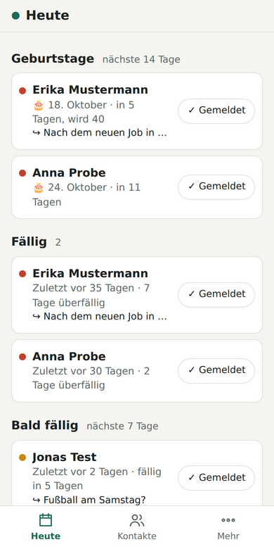
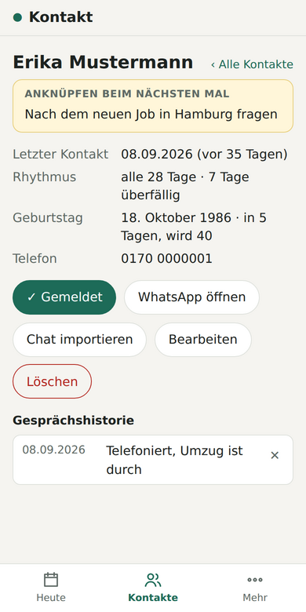
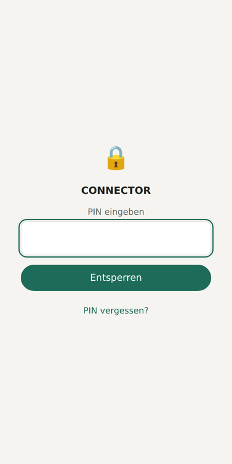

# CONNECTOR – Kontaktpflege fürs Handy

CONNECTOR erinnert Sie daran, sich regelmäßig bei den Menschen zu melden, die Ihnen wichtig sind. Die App zeigt, wann Sie zuletzt Kontakt hatten, wer wieder dran ist, wer bald Geburtstag hat und woran Sie beim nächsten Gespräch anknüpfen wollten.

**App öffnen und installieren: https://lars-grahneis.github.io/CONNECTOR/**

Kostenlos, ohne Konto, ohne Werbung, ohne App Store. Die App startet leer; Sie tragen Ihre eigenen Kontakte ein.

  
  
  

*Bildschirmfotos mit erfundenen Beispieldaten.*

## Datenschutz: Ihre Daten bleiben auf Ihrem Gerät

- **Kein Server, keine Cloud, kein Konto.** Kontakte, Notizen und Geburtstage werden nur im Speicher Ihres Browsers auf Ihrem Gerät abgelegt.
- **Keine Synchronisation zwischen Geräten.** Jedes Gerät hat seinen eigenen, getrennten Datenbestand. Das ist Absicht: Weil nichts abgeglichen wird, werden auch **keine Daten an externe Server übertragen**. Niemand außer Ihnen – auch nicht der Entwickler – kann Ihre Kontakte sehen.
- **Technisch abgesichert:** Eine Sicherheitsrichtlinie (Content Security Policy) in `index.html` verbietet der App Verbindungen zu fremden Servern. Es gibt keine Analyse-, Tracking- oder Werbedienste und keine nachgeladenen Fremdbibliotheken.
- **Einzige Ausnahme, von Ihnen ausgelöst:** Der Knopf „WhatsApp öffnen“ öffnet `wa.me` mit der Telefonnummer der Person.
- **WhatsApp-Chats:** Ein importierter Chat-Export wird nur gelesen; gespeichert wird nur das Datum der letzten Nachricht, nicht der Chattext.
- **Offener Quellcode:** Jeder kann den Code in diesem Repository prüfen. Er enthält keine personenbezogenen Daten; alle Testdaten sind erfunden.

Folge daraus: **Sie sind selbst für Ihre Sicherung verantwortlich.** Löschen Sie die Browserdaten oder wechseln Sie das Handy, sind die Kontakte ohne Sicherung weg (siehe unten).

## Funktionen

- **Heute:** überfällige und bald fällige Kontakte, Geburtstage der nächsten 14 Tage
- **Kontaktkarte:** „Anknüpfen beim nächsten Mal“, letzter Kontakt, Wunsch-Rhythmus (wöchentlich, alle 2 oder 4 Wochen oder frei), Geburtstag, Gesprächshistorie
- **„✓ Gemeldet“:** setzt das Datum auf heute und nimmt eine Notiz auf
- **Anrufen bzw. schreiben:** „WhatsApp öffnen“ direkt aus der Kontaktkarte
- **Kontakte übernehmen:** aus dem Telefonbuch (Chrome auf Android), als vCard-Datei oder von Hand
- **WhatsApp-Chat-Import:** übernimmt das Datum des letzten Kontakts aus einem Chat-Export
- **Geburtstage in den Kalender:** Export als `.ics` für Google Kalender, damit auch bei geschlossener App erinnert wird
- **Datensicherung:** als Datei, auf Wunsch mit Passwort verschlüsselt
- **App-Sperre:** PIN (4–6 Ziffern) beim Öffnen und nach 5 Minuten im Hintergrund
- **Offline nutzbar**, heller und dunkler Modus

## Installation (Android)

1. Auf dem Handy in **Chrome** öffnen: https://lars-grahneis.github.io/CONNECTOR/
2. Unten „Mehr“ → **„App installieren“**. Erscheint der Knopf nicht: Chrome-Menü ⋮ → „App installieren“ bzw. „Zum Startbildschirm hinzufügen“.
3. CONNECTOR hat jetzt ein eigenes Symbol und öffnet sich ohne Browserleiste.

Updates kommen automatisch, sobald Sie die App mit Internetverbindung öffnen. Getestet ist CONNECTOR mit Chrome auf Android. Andere Browser und iPhone sind nicht getestet; Telefonbuch-Auswahl und „Teilen → CONNECTOR“ gibt es dort nicht.

## Erste Schritte

1. **Sperre einrichten (empfohlen):** „Mehr“ → „App-Sperre“ → „PIN festlegen“. Die PIN lässt sich nicht wiederherstellen.
2. **Kontakte anlegen:** „Mehr“ → „Aus Telefonbuch wählen“, „vCard-Datei“ oder „Von Hand“.
3. **Rhythmus und Geburtstag** pro Kontakt unter „Bearbeiten“ eintragen.
4. **Nach jedem Gespräch** „✓ Gemeldet“ tippen und notieren, woran Sie nächstes Mal anknüpfen wollen.

## Datensicherung

„Mehr“ → **„Sicherung erstellen“** → Passwort vergeben → „Auf Gerät speichern“ oder „Senden“ (z. B. in Ihr Google Drive).
Wiederherstellen: „Mehr“ → **„Sicherung einspielen“** → Datei wählen → Passwort → „Zusammenführen“. Alternativ die Datei in der Dateien- oder Drive-App über **Senden → CONNECTOR** öffnen.

Die verschlüsselte Sicherung (AES-GCM, Schlüssel per PBKDF2-SHA-256 mit 600 000 Iterationen) kann ohne Passwort niemand lesen. Das Passwort wird nirgends gespeichert; ohne Passwort ist auch die Wiederherstellung nicht möglich.

Mit derselben Sicherung können Sie die Daten auch auf ein anderes Gerät übertragen – von Hand, nicht automatisch.

## Grenzen

- **Keine Benachrichtigungen bei geschlossener App:** Erinnerungen sehen Sie beim Öffnen auf „Heute“. Für Geburtstage gibt es den Kalender-Export.
- **Die App-Sperre schützt vor neugierigen Blicken,** nicht vor technisch versiertem Zugriff auf ein entsperrtes Gerät; die Daten im Browser-Speicher sind nicht verschlüsselt. Der wichtigste Schutz ist die Bildschirmsperre Ihres Handys.
- **WhatsApp bietet keine Schnittstelle** für private Konten; Chats lassen sich nur über den Export einlesen.

## Für Entwicklerinnen und Entwickler

Reines HTML, CSS und JavaScript ohne Build-Schritt und ohne externe Abhängigkeiten.

- Lokal starten: im Repository-Ordner `python3 -m http.server`, dann http://localhost:8000/ öffnen.
- Tests (Node.js 20+): `npm test`
- Eigene Kopie veröffentlichen: Repository forken, unter Settings → Pages „Deploy from a branch“ mit `main` und `/ (root)` wählen.

| Datei | Inhalt |
|---|---|
| `index.html`, `styles.css` | Seite, Gestaltung, Sicherheitsrichtlinie |
| `js/app.js` | Oberfläche und Abläufe |
| `js/model.js`, `js/dates.js` | Fälligkeit, Geburtstage, Datumsrechnung |
| `js/whatsapp.js`, `js/vcard.js`, `js/ics.js`, `js/phone.js` | Chat-Export, vCard, Kalenderdatei, WhatsApp-Nummer |
| `js/db.js` | Lokaler Speicher (IndexedDB) |
| `js/crypto.js`, `js/backup.js` | Verschlüsselte Sicherung, tolerantes Einlesen |
| `js/lock.js` | App-Sperre |
| `sw.js`, `manifest.webmanifest` | Offline-Betrieb, Installation, Teilen-Ziel |
| `SPEC.md` | Spezifikation und Änderungen je Version |

Lizenz: [MIT](LICENSE) – Sie dürfen den Code frei nutzen, verändern und weitergeben, solange der Lizenzhinweis erhalten bleibt.

Fehler und Wünsche bitte als [Issue](https://github.com/lars-grahneis/CONNECTOR/issues) melden – **niemals echte Kontaktdaten in ein Issue schreiben**, das Repository ist öffentlich.

## Autor

Lars Grahneis, Assistenzarzt Pathologie, Universitätsklinikum des Saarlandes (UKS), Homburg
